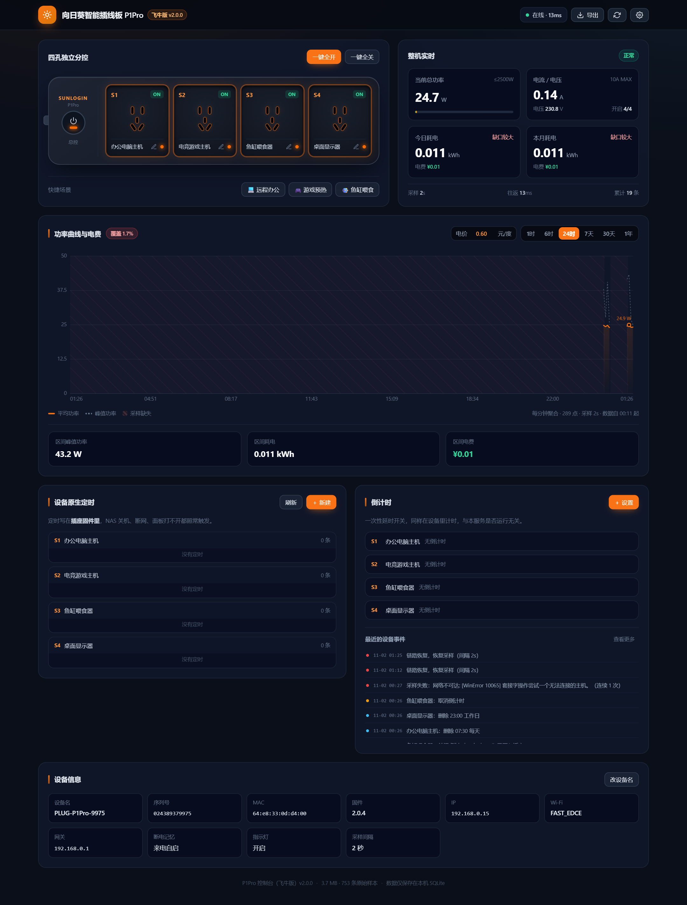
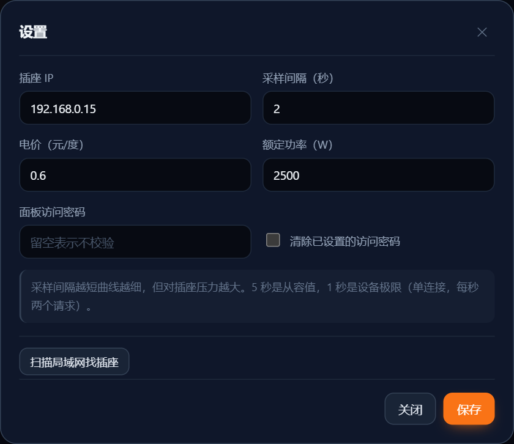

# 向日葵 P1Pro 智能插线板 · 飞牛版

**飞牛 fnOS 原生应用包（`.fpk`）**。在应用中心装一次，桌面多一个图标，点开就是插座面板：
直连插座局域网 `:6767`，不经过椰壳云端，采集功率曲线、算电费、管四个插口，
还能给插座写**设备原生定时**（NAS 关机也照常触发）。

* **飞牛原生** —— 按官方 `fnpack` 规范打包：`manifest` + 向导 + 生命周期脚本，可在应用中心安装、升级、卸载
* **零第三方依赖** —— 只用 Python 3 标准库，`pip install` 一个包都不用
* **零 CDN** —— 前端手写 CSS + 自研 Canvas 图表，断网、纯内网都能正常显示
* 数据全在本机 SQLite（应用自己的 `var` 目录），随时导出 CSV

> 这是**飞牛版**，和之前的 OpenWrt LuCI 插件（[luci-app-sunlogin-p1pro](https://github.com/52sanmao/luci-app-sunlogin-p1pro)）是两套东西。
> 路由器插件走 procd + rpcd + UCI，为 128MB 内存的 OpenWrt 设计；
> 这套按飞牛应用规范打包，Python 常驻 + SQLite，能存几个月的曲线。

---

## 它不能做什么（先说清楚，省得你踩坑）

| 你可能想要的 | 实际情况 |
|---|---|
| 查看**历史**用电曲线 | ❌ 插座**一个字节的历史都不存**。`get_plug_electric` 只回电压/电流/功率三个瞬时值，16 个历史类方法名实测全返回 `result:1`。曲线只能从**本服务第一次启动**开始累计 |
| 看**每个插口**各自的功率 | ❌ 固件只测整机总功率，四个口共用一套计量。面板上不会给单口编一个假数字 |
| 秒级/百毫秒级采样 | ⚠️ 设备是 ESP8266 单连接，一次往返约 34 ms，同一时刻只接受一个 TCP 连接。默认 2 秒一次，最小允许 1 秒 |
| 云端远程控制 | ❌ 本项目只走局域网直连。要外网访问请自己配 VPN / 反代，并务必设访问密码 |

---

## 安装

### 方式一：飞牛应用中心装（推荐）

1. 下载本仓库 Releases 里的 `p1pro.fpk`（或自己 `bash tools/build_fpk.sh` 打一个）
2. 飞牛桌面 → **应用中心** → 右上角 **手动安装** → 选 `p1pro.fpk`
3. 选个存储空间，向导里填插座 IP（默认 `192.168.0.15`）、端口（`6767`）、可选的访问密码
4. 装完桌面出现「P1Pro 智能插座」图标，点开即用，地址是 `http://<NAS-IP>:8787`

**前提**：系统里有 Python 3.7+（飞牛基于 Debian，一般自带；没有就在终端 `sudo apt install -y python3`）。
安装脚本会先检查，缺了会直接提示并中止，不会让你装完才发现打不开。

### 方式二：Docker

飞牛自带 Docker 面板，SSH 上去也行：

```bash
git clone https://github.com/52sanmao/sunlogin-p1pro-nas.git
cd sunlogin-p1pro-nas
nano docker-compose.yml     # 改 P1PRO_HOST 为插座 IP
docker compose up -d
docker compose logs -f
```

浏览器打开 `http://<NAS-IP>:8787`。

> 用 `network_mode: host`：容器要访问内网 `192.168.x.x` 上的插座，host 模式最省事，
> 也省掉端口映射和"局域网发现"的一堆麻烦。

### 方式三：裸跑（不用飞牛应用包，也不用 Docker）

```bash
cd sunlogin-p1pro-nas
cp config.example.json config.json
nano config.json                      # 改 device.host

python3 app/server/app.py --check     # 自检：能不能连上插座
python3 app/server/app.py             # 启动

sudo sh install.sh /vol1/1000/apps/p1pro   # 或者装成 systemd 服务
```

自检通过长这样：

```
目标 192.168.0.15:6767
  get_plug_sn   OK   sn=... type=...
  get_plug_info OK   name=... fw=... mac=...
  status        OK   插口=1111 led=1 def_st=2
  electric      OK   24.70 W / 230.0 V / 140 mA
  往返耗时 34 ms，自检通过
```

---

## 飞牛应用规范这一层是怎么回事

装完后飞牛会建好这套目录，`cmd/` 里的脚本在各个时点被调用：

```
/var/apps/p1pro/
├── target -> /vol1/@appcenter/p1pro     代码（app/server 就是运行文件）
├── etc    -> /vol1/@appconf/p1pro       配置 config.json
├── var    -> /vol1/@appdata/p1pro       数据库 p1pro.db + logs/app.log
├── cmd/                                 生命周期脚本
├── config/privilege                     运行身份（run-as=package）
└── wizard/                              安装 / 配置 / 卸载时的表单
```

| 脚本 | 干什么 |
|---|---|
| `install_init` | 检查 Python 3.7+ 与 sqlite3 模块，缺了就把原因写进飞牛的安装日志并中止 |
| `install_callback` | 把向导填的 IP / 端口 / 密码写成 `etc/config.json`（用 Python 生成 JSON，不是拼字符串） |
| `main start\|stop\|status` | 启停面板；`start` 会等端口真正可连才返回 0，`status` 未运行返回 3 |
| `config_init` | 应用设置提交前重新校验 IP / 端口 / 密码长度 |
| `config_callback` | 写回配置；**原来在跑就重启，原来停了就不擅自拉起** |
| `upgrade_init` / `upgrade_callback` | 升级前备份 `config.json`，升级后补目录权限、清理残留 pid |
| `uninstall_init` | 按卸载向导的选择决定删不删数据，**默认保留** |
| `uninstall_callback` | 收尾清理 |

几个刻意的取舍：

* **以应用专用用户运行**（`run-as=package`），不用 root。面板监听的是普通高端口、只读本地 SQLite，没有需要 root 的理由。
* **错误信息写进 `TRIM_TEMP_LOGFILE`**，飞牛会把它展示给用户。比如没装 Python 时用户看到的是
  "本应用需要 Python 3.7 及以上……"，而不是一句"安装失败"。
* **卸载默认保留数据**。卸载是"不用了"，不是"删数据"；要删得在卸载向导里明确选。

### 应用到面板的配置对应关系

| 想改什么 | 去哪改 |
|---|---|
| 插座 IP / 端口 | 应用设置（向导会重新跑一遍 `config_init`）或面板右上角「设置」 |
| 访问密码 | 面板「设置」→ 面板访问密码（勾"清除"即关闭鉴权） |
| 电价、采样间隔、额定功率、插口标签、设备名 | 面板里改，存 `etc/config.json` 与设备本身 |
| 历史数据 | `/vol1/@appdata/p1pro/p1pro.db`，卸载时选"保留"会留在原处 |

---

## 界面里有什么

- **四孔独立分控** —— 点插口图直接开关，带总控和一键全开/全关
- **快捷场景** —— 远程办公 / 游戏预热 / 鱼缸喂食，一次下发四个口的状态
- **整机实时** —— 总功率、电流电压、今日/本月耗电与电费，负载条按额定功率着色
- **功率曲线** —— 1 小时 ~ 1 年六档；**采集中断的地方画成斜纹并断开折线**，不会连成一条假直线
- **设备原生定时** —— 每口可挂多条定时，写在插座固件里，NAS 关机也照常触发
- **倒计时** —— 延时开/关，同样在设备里计时，界面实时倒数
- **设备信息** —— 改名（真写进插座）、SN、MAC、固件、Wi-Fi、断电记忆状态



设置弹窗里除了电价和采样间隔，还能改访问密码（飞牛装完不用再回应用设置）：



---

## 数据存在哪

一个 SQLite 文件：`var/p1pro.db`（飞牛上就是 `/vol1/@appdata/p1pro/p1pro.db`），四层金字塔。

| 层 | 粒度 | 保留 | 用途 |
|---|---|---|---|
| `sample` | 原始样本（2 秒一条） | 7 天 | 精确曲线、CSV 导出 |
| `bucket/min` | 每分钟：平均/峰值/谷值/电量/样本数/最大间隔 | 400 天 | 24 小时图、日/月汇总 |
| `bucket/hour` | 每小时 | 永久 | 7 天/30 天图 |
| `bucket/day` | 每天（本地自然日） | 永久 | 1 年图 |

体积参考：2 秒采样约 **4.3 万条/天**，原始样本留 7 天约 30 万行、20 MB 上下；长年运行的主要占用来自分钟层的 400 天。

### 导出

界面上点「导出」下载最近 7 天的分钟级 CSV（带 BOM，Excel 直接打开不乱码）。
想要别的粒度直接打 API：

```bash
# 原始样本（2 秒一条，7 天约 30 万行）
curl -o raw.csv 'http://NAS:8787/api/export?type=raw&days=7'

# 小时级 / 天级
curl -o hour.csv  'http://NAS:8787/api/export?type=hour&days=30'
curl -o day.csv   'http://NAS:8787/api/export?type=day&days=365'
```

CSV 里除数值外还带 `samples` 和 `max_gap_seconds` 两列 ——
**判断某一行是不是可信，看这两个数字**，别只看电量。

---

## 这一版修掉了什么

针对上一轮代码审查列出的第 11～15 条，以及 5.4 / 5.5 两节：

### 11. 24 小时曲线原来不是曲线 → 改成真正的分层聚合

旧实现 `power_24h_mw[hour] = new_power`，每小时 20 次采样只留最后一次，
开 5 秒的电水壶在图上完全不可见，空载一小时里偶尔采到一次波动却会画出尖峰。

现在每分钟算一次**时间加权平均**，同时单独记 `p_max` / `p_min`，曲线画平均、虚线画峰值。
降采样时按样本数加权，不会因为合并而失真。

### 12 / 5.4 缺数据显示成 0 → 改成 `null` + 覆盖率

断电、重启、插座离线期间积分不累加，旧版界面就是 `0.000 kWh`，
用户读到的是"没耗电"，事实是"没采到"。

现在每个桶都记 `n`（实际样本数）和 `gap`（桶内最大采样间隔），查询时算覆盖率：

| 覆盖率 | 返回 | 界面 |
|---|---|---|
| ≥ 80% | 数值 | 正常 |
| 20% ~ 80% | 数值 + `partial: true` | 提示"覆盖 xx%" |
| < 20% | `null` | **断线**，该段画斜纹 |

顺带修了一个更容易骗人的 bug：整体覆盖率原本按"有数据的点跨度"算，
刚部署只有两分钟数据时会算出 100%。现在按**请求的整段时间范围**算，
24 小时里只有 15 分钟数据就老老实实显示"覆盖 <1%"。

曲线的时间轴也做了补齐 —— 没有数据的桶返回 `null` 点而不是干脆不返回，
否则"缺一段"在图上会画成"什么也没有"，看起来像数据完整。

### 13 / 5.5 设备自带 6 个接口一个都没用 → 全部接上

| 接口 | 现在用它做什么 |
|---|---|
| `plug_timer_get` / `plug_timer_add` / `plug_timer_del` | 每口多条定时，界面可增删；**写在插座固件里，NAS 关机也生效** |
| `plug_cntdown_get` / `plug_cntdown_add` / `plug_cntdown_del` | 延时开/关，界面实时倒数剩余时间 |
| `set_plug_name` | 「改设备名」真写进插座，向日葵官方 App 同步可见 |
| `set_plug_dfltstat` | 断电记忆（来电自启/保持关闭） |

三个必须踩过才知道的坑，代码里都处理了：

1. `time` 字段是 **UTC 0 点起的分钟数**，不是本地时间。北京 07:30 要填 `1410` 而不是 `450`。
   填错不报错，只是**永远不触发** —— 本项目在服务端做换算，界面只让你填本地时间。
2. `repeat` 是**星期位图**，bit0=周日。`127` 每天 / `62` 工作日 / `65` 周末 / `0` 仅一次。
3. `plug_timer_get` 没定时时只返回 `{"result":0}`，**连 `timer` 字段都没有**。只看 `result` 会误判成"有定时"。

另外 `plug_timer_set`（整体覆盖）实测恒返回 `9`，固件没实现，所以只能 add/del。

### 14. 改名只改本地标签 → 现在区分两种名字

- **插口名称**：设备固件不支持给单个插口命名，所以这是本面板的标签，存在 NAS 上。
  界面上明确写清楚，不会再让人以为官方 App 也会变。
- **设备名称**：走 `set_plug_name`，真写进插座，官方 App 同步。

### 15. IP 无校验 / 名称未转义 / 配置非原子写 → 全部处理

- IP 输入校验（安装脚本用 `ipaddress` 严格校验，`192.168.0.999` 这类值会被拒绝）+ 局域网自动扫描（`/api/discover`，扫 /24 约 5 秒）
- 名称输入限长 32 字符，前端 `esc()` 转义后再进 DOM
- 配置写入改为 `写临时文件 → fsync → os.replace`，断电不会留半截 JSON；
  被手工改坏时自动备份为 `.broken` 并用默认值启动，服务不会起不来

### 飞牛版额外做的

| 项 | 说明 |
|---|---|
| 采集更密 | 默认 2 秒一条，可调到 1 秒；单次往返 34 ms，2 秒间隔占用率不到 4%，对单连接设备仍是安全水位 |
| 数据落盘 | SQLite 四层金字塔，面板关掉、NAS 重启都不丢；不再依赖内存数组 |
| 曲线显示 | 断线/斜纹/峰值虚线/覆盖角标/悬停十字线；时间轴自动补齐 |
| 原生打包 | `fnpack` 规范：向导、生命周期、权限、图标齐备，应用中心可管 |
| 面板改密码 | 不用回应用设置，面板「设置」里就能改或清除访问密码 |

### 顺带修掉的旧版隐患

| 旧版问题 | 这一版 |
|---|---|
| 静态盐 `01010000`（依赖"固件不校验时间"这个缺陷） | 改回实时 `MMddHHmm` |
| 鉴权失败不自愈，换插座后永久离线 | `result:3` 时清 SN 缓存、重走发现、重试一次 |
| 并发打单连接设备 | 全局串行锁 + 35 ms 最小请求间隔 |
| 采样失败后傻等 | 指数退避 2→4→8…最长 60 秒 |
| 无单实例保护 | 端口占用直接报错退出，不会抢控制权 |

---

## 协议速查

```
GET http://<IP>:6767/plug?_api=<方法>&<参数>&time=<MMddHHmm>&key=<MD5>
key = MD5(sn + "==smart-plug==" + time)
```

- `get_plug_sn` **免鉴权**，先拿 SN 再算 key
- HTTP/1.0，`Content-Type: text/plain`，GET/POST 都行，PUT/DELETE 断连
- 单位全是"千分之一"：`vol` mV、`curr` µA、`power` mW
- **不要拿 `P = U × I` 反推**：`curr` 是视在电流，`power` 是有功功率，本机功率因数约 0.39
- 返回码：`0` 成功 / `1` 未知方法 / `3` 鉴权失败 / `4` 缺参 / `5` 索引越界或取值非法 / `9` 目标不存在 / `11` 该口无倒计时

完整实测文档（20 个方法、每个都附真实返回）见 [docs/协议实测.md](docs/协议实测.md)。

---

## HTTP API

所有接口返回 JSON，写操作统一 `POST` + JSON body。设了访问密码后需带
`X-P1Pro-Token` 头或 `?token=` 参数。

| 方法 | 路径 | 说明 |
|---|---|---|
| GET | `/api/bootstrap` | 首屏一次性拿全（配置 + 状态 + 汇总 + 存储） |
| GET | `/api/state` | 采集器内存快照（0 延迟，不碰设备） |
| GET | `/api/series?range=24h` | 曲线；range ∈ `1h/6h/24h/7d/30d/1y` |
| GET | `/api/summary` | 今日/本月/近7天/本年 |
| GET | `/api/device` | 设备信息（15 秒缓存） |
| GET | `/api/timers` · `/api/countdowns` | 四口定时 / 倒计时 |
| GET | `/api/events?limit=60` | 事件日志（开关、断连、定时增删） |
| GET | `/api/export?type=&days=` | CSV 导出 |
| POST | `/api/switch` | `{scope:'all'\|'one', index, status}` |
| POST | `/api/switch_many` | `{name, statuses:[1,0,1,1]}` 场景 |
| POST | `/api/timer` | `{op:'add'\|'del', index, hour, minute, action, repeat}` |
| POST | `/api/countdown` | `{op:'add'\|'del', index, action, seconds}` |
| POST | `/api/led` · `/api/default_state` · `/api/device_name` · `/api/socket_label` | 杂项 |
| POST | `/api/config` | 改电价 / 采样间隔 / 插座地址 / 额定功率 / 访问密码 |
| POST | `/api/discover` | 扫局域网找插座 |
| GET | `/api/health` | 健康检查（不需要口令，给容器和监控用） |

---

## 配置项

`config.json`（飞牛上位于 `etc/config.json`）：

```jsonc
{
  "device":  { "host": "192.168.0.15", "port": 6767, "timeout": 3.0 },
  "sampler": { "interval_seconds": 2, "backoff_max_seconds": 60 },
  "storage": { "db_path": "/vol1/@appdata/p1pro/p1pro.db", "raw_retention_days": 7, "minute_retention_days": 400 },
  "web":     { "host": "0.0.0.0", "port": 8787, "access_token": "" },
  "billing": { "price_per_kwh": 0.6 },
  "sockets": ["办公电脑主机", "电竞游戏主机", "鱼缸喂食器", "桌面显示器"],
  "limits":  { "rated_watts": 2500 }
}
```

缺字段不要紧：启动时按默认值补齐，只覆盖你写了的键。

环境变量（容器用）：`P1PRO_CONFIG`、`P1PRO_HOST`、`P1PRO_PORT`、`P1PRO_TOKEN`、`P1PRO_DB`，
只在**首次启动**（配置文件不存在时）播种，之后以配置文件为准。

飞牛注入的 `TRIM_*` 变量由 `cmd/main` 使用：`TRIM_APPDEST`（代码）、`TRIM_PKGETC`（配置）、
`TRIM_PKGVAR`（数据）、`TRIM_SERVICE_PORT`（端口）、`TRIM_TEMP_LOGFILE`（报错展示）、`TRIM_USERNAME`（运行用户）。

---

## 打包与开发

```bash
# 打包成 p1pro.fpk（首次会自动下载 fnpack，之后离线）
bash tools/build_fpk.sh

# 重新生成图标（改配色时用，需要 Pillow）
python3 tools/make_icons.py

# 端到端冒烟测试：起模拟插座 + 起服务，跑 50 项断言，不需要真机
python3 tests/smoke_test.py
```

`tools/build_fpk.sh` 会先做三件事再打包：把 `cmd/` 脚本统一成 LF（Windows 上编辑过的
CRLF 装到飞牛会报 `bad interpreter: /bin/bash^M`）、补可执行位、`bash -n` 语法自检。

---

## 常见问题

**Q：应用中心安装时提示缺少 Python？**
飞牛基于 Debian，一般自带 python3。确实没有就在终端 `sudo apt install -y python3`，然后重新安装。
安装脚本会在 `install_init` 里检查版本（需 3.7+）和 sqlite3 模块。

**Q：装完点图标打不开？**
先看 `/vol1/@appdata/p1pro/logs/app.log`，再看应用中心里的启动状态。
常见原因：8787 被别的应用占了（`manifest` 里声明了 `service_port`，飞牛启动前会检查端口）、
或者 `etc/config.json` 里的插座地址填错了。地址错了不影响启动，面板会显示"离线"。

**Q：面板显示离线，但向日葵官方 App 能控制？**
说明局域网直连不通。先 `python3 app/server/app.py -c etc/config.json --check`，它会逐步打印四个接口的结果。
常见原因：插座换过 IP（用「扫描局域网」重新找）、NAS 有多个网段没路由到插座所在网段。

**Q：曲线一直是空的？**
插座不存历史，从本服务启动开始累计。另外确认 var 目录可写 ——
如果 SQLite 打不开，状态会一直正常但曲线永远为空，日志里会有"写入数据库失败"。

**Q：为什么点开关有时候慢半拍？**
ESP8266 单连接，请求是串行的。采样线程每 2 秒占两次请求，你的点击要排在这之后，最坏等 2 秒左右。
把采样间隔调大能快一点。

**Q：能同时跑两个实例吗？**
不能。端口会冲突；就算换端口，两个进程会互相抢插座的单连接，表现为随机超时。一个 NAS 一个实例。

**Q：想让局域网里谁都能看、但不能乱按开关？**
目前没有只读角色。要么设访问密码（知道密码的人能操作），要么把端口用反代限制到固定 IP。

**Q：卸载后数据还在吗？**
默认还在，`/vol1/@appdata/p1pro/` 会保留。要彻底删掉，卸载向导里选「全部删除」——
脚本只删这个应用的目录，路径对不上会拒绝执行。

---

## 目录结构

```
sunlogin-p1pro-nas/
├── manifest                    飞牛应用元数据（版本、端口、桌面入口）
├── ICON.PNG / ICON_256.PNG     应用图标
├── app/
│   ├── ui/
│   │   ├── config              桌面入口定义（URL 类型，指向 8787）
│   │   └── images/             图标 64 / 256
│   └── server/                 ← 运行文件，装完在 target/server
│       ├── app.py              入口（参数、自检、启动、优雅退出）
│       ├── p1pro/
│       │   ├── protocol.py     6767 协议客户端（鉴权、自愈、串行化）
│       │   ├── store.py        SQLite 四层聚合 + 覆盖率计算
│       │   ├── sampler.py      采集线程（指数退避）
│       │   ├── server.py       HTTP 路由 + 静态文件 + CSV 导出
│       │   └── config.py       配置读写（原子落盘）
│       └── static/
│           ├── index.html
│           ├── style.css       手写 CSS，无框架
│           ├── chart.js        自研 Canvas 时序图
│           └── app.js          前端逻辑
├── cmd/                        九个生命周期脚本
├── config/privilege            运行身份（package）
├── config/resource             资源声明（本应用不需要共享目录）
├── wizard/                     install / config / uninstall 表单
├── tools/
│   ├── build_fpk.sh            一键打包
│   └── make_icons.py           图标生成
├── tests/                      模拟设备 + 50 项冒烟测试
├── docs/协议实测.md             20 个接口的真机返回记录
├── Dockerfile · docker-compose.yml · install.sh
```

---

## 许可

MIT
